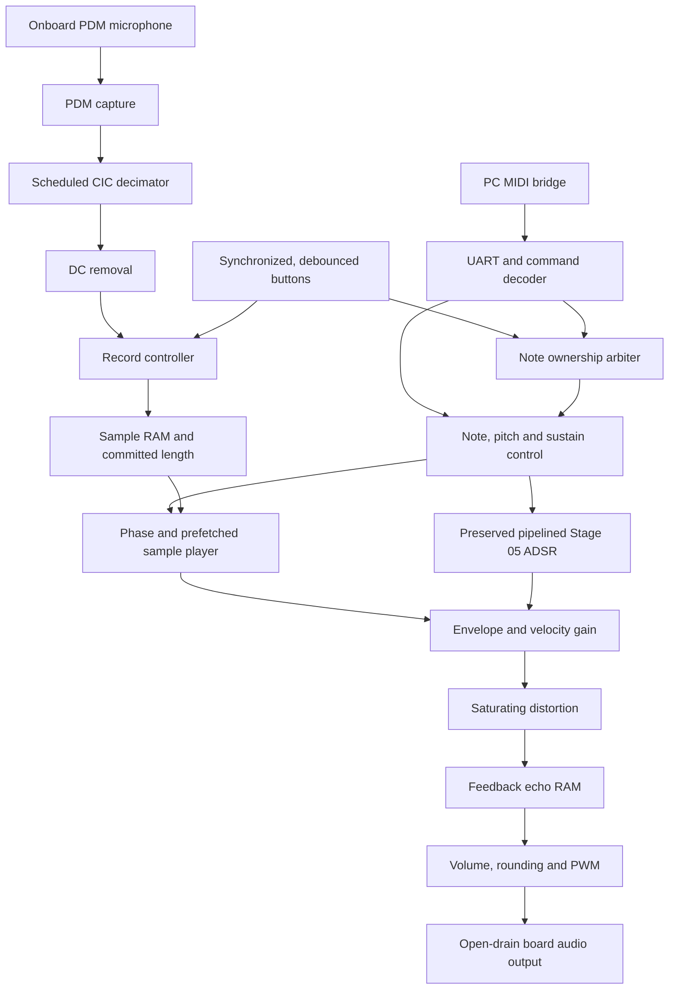
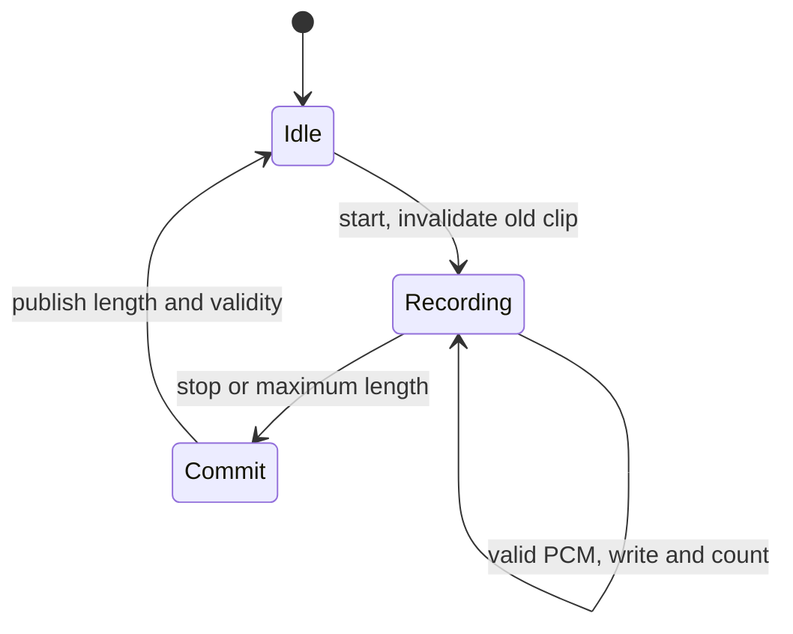

# Live sampler architecture

## Scope and signal flow

One internal 100 MHz clock drives every register. Audio timing uses a one-cycle clock enable every 6,250 system clocks. The microphone clock is a registered output to the external microphone, not an internal clock domain. Portable arithmetic, RAM, protocol, and timing logic live in `src/core/`; physical pins, buttons, switches, indicators, and open-drain audio wiring live in `src/platform/nexys4ddr/` and the XDC.

The UART-to-note-control connection carries pedal/panic state; note-on/off events pass through the ownership arbiter. The player contains the phase accumulator and linear interpolator. The sample tick feeds player and envelope concurrently. Switch states select interpolation, distortion, echo, and output volume; effect/volume controls are latched for each audio transaction. The board top connects the microphone, controls, `sampler_core`, and PWM. `sampler_core` contains the recording/playback RAM and audio chain.

## Definitive component organization

All paths below are relative to the repository root. `vivado/sources.tcl` contains the exact dependency order.

| Directory | Files | Responsibility |
|---|---|---|
| `src/core/common/` | `audio_pkg.vhd` | Signed PCM types, MIDI range/root constants, widening and explicit rounding/saturation. |
| `src/core/common/` | `sample_tick_generator.vhd` | One-clock audio enable; default 16 kHz. |
| `src/core/common/` | `input_synchronizer.vhd`, `button_debouncer.vhd` | Two-register receiving chain and reusable stable-level/button-press detection. |
| `src/core/interfaces/` | `pdm_capture.vhd` | External microphone clock/select, startup delay and selected-phase bit capture. |
| `src/core/interfaces/` | `uart_rx.vhd`, `pwm_generator.vhd` | Serial receiver and logical signed-PCM-to-PWM conversion. |
| `src/core/control/` | `note_command_decoder.vhd` | Explicit note, sustain and panic packet decoding. |
| `src/core/control/` | `note_input_arbiter.vhd` | Audition/UART ownership and coincident-event priority. |
| `src/core/control/` | `note_event_manager.vhd` | Monophonic note gate, velocity and UQ2.16 pitch lookup. |
| `src/core/memory/` | `record_controller.vhd` | Record ownership, exact length, last-write commit and validity. |
| `src/core/memory/` | `sample_ram.vhd` | Synchronous read, independent write port, optional initialization. |
| `src/core/audio/` | `pdm_decimator.vhd`, `dc_blocker.vhd` | Scheduled CIC and fixed-point DC removal. |
| `src/core/audio/` | `phase_accumulator.vhd`, `sample_player.vhd`, `linear_interpolator.vhd` | Runtime clip wrapping, RAM-prefetch schedule and interpolated playback. |
| `src/core/audio/` | `adsr_envelope.vhd`, `audio_gain.vhd` | Preserved Stage 05 envelope and registered gain/velocity products. |
| `src/core/audio/` | `sampler_core.vhd` | Portable record/note/voice/effects integration and transaction alignment. |
| `src/core/effects/` | `distortion.vhd`, `delay_effect.vhd` | Saturating drive and signed-16 feedback delay. |
| `src/platform/nexys4ddr/` | `top_nexys4ddr.vhd` | Board control wiring, microphone path, UART arbitration, LEDs and audio pins. |
| `constraints/` | `nexys4ddr.xdc` | Exact pins, 10 ns clock and targeted input exceptions. |
| `sim/unit/`, `sim/integration/` | 24 permanent VHDL benches | Component boundaries and complete transactions. |
| `tools/` | Conversion, MIDI bridge, test runners and report merger | PC preparation/control and reproducible verification. |
| `vivado/` | Six Tcl scripts | Source manifest, isolated project, memory staging, regression and report export. |

## Interfaces, representation and latency

An input accepted at edge N is sampled immediately before that edge. An output described as N+k is registered immediately after that later edge; a downstream clocked process consumes it on the following edge. Valid flags travel with their data. Reset is synchronous unless a module explicitly documents its physical receiving chain.

| Boundary | Representation and contract |
|---|---|
| Microphone input | One bipolar PDM bit per 50 system clocks, 2 MHz. Capture publication is two clocks after the selected microphone rising edge. |
| Decimator | Three integrators/three combs, signed modulo-2^32 arithmetic, R=125; accepted final bit N to PCM N+6. At least three clocks between input bits. |
| DC blocker | Signed-8 input/output; Q8 signed internal state; input N to output N+2, minimum spacing three clocks. |
| Record input | Signed-8 PCM plus one-cycle valid. Default sample period is 62.5 us. |
| RAM | 16,384 x 8 by default; one synchronous read register and an independent synchronous write port. No array reset. |
| Recorded length | `ADDR_BITS+1` unsigned bits; valid lengths 4..`SAMPLE_COUNT`, up to the full RAM depth. An extra bit is necessary to represent 16,384. |
| Pitch step | UQ2.16, 18 bits: step69=65536, step57=32768, step81=131072. Maximum supported table step is 155872. |
| Phase | UQ14.16 by default; wrapped at the committed clip length. |
| Player | Prefetches synchronous RAM neighbors between audio ticks. Ready permits a subsequent tick at N+8. Invalid/changing clip length flushes the prefetch and phase. |
| Interpolation | Signed-8 samples; full signed-9 difference, fractional multiply and registered result. N to N+2. Delta rounds nearest, ties away from zero. |
| ADSR | Unsigned-16 gain; exact uploaded pipeline, N to N+2. Minimum tick spacing three clocks; no `ready_out` port. |
| Audio gain | Signed-8 x unsigned-16 x velocity coefficient; N to N+2, input can be accepted every clock. Scaling retains Stage 07 floor behavior. |
| Distortion | Signed-8, x2/x4 then saturate. One registered stage. |
| Echo | Signed-16, default 4,096 samples =256 ms. Accepted N to output N+1; one transaction per two clocks. |
| Output | Arithmetic volume shift 0..3 on signed-16, then round/saturate to PCM8. Logical PWM value latches only at its 256-clock boundary. |

The complete microphone acquisition chain produces its filtered PCM twelve system clocks after the final selected microphone edge for a decimation block. The CIC discards the first two candidate outputs. Default warmup is 50 ms; microphone readiness follows warmup and the first published decimated sample. DC state continues advancing between recordings.

## Playback transaction schedule

The core requires sample ticks at least 16 system clocks apart. Production uses 6,250, so the deterministic schedule has ample sample-period headroom without using additional internal clocks. This headroom does not exempt individual register-to-register paths from the 10 ns timing requirement.

| Edge | Operation |
|---|---|
| N | Player publishes its prefetched PCM; ADSR captures its next interpolation operands. Core captures velocity and effect/volume settings. |
| N+1 | Core captures the player's PCM. ADSR registers its product. |
| N+2 | Preserved ADSR publishes gain, gain-valid and aligned status. |
| N+3 | `audio_gain` accepts the matched PCM, gain and velocity. |
| N+4 | Velocity product registers. |
| N+5 | Gain output and valid register. |
| N+6 | Distortion output and valid register. |
| N+7 | Echo accepts the sample and reads its history RAM. |
| N+8 | Echo writes feedback and publishes output. |
| N+9 | Core publishes volume-scaled, rounded PCM8 and `pcm_valid`. |

The final PCM transaction latency is 90 ns from the playback tick, excluding initial prefetch, the audio sample cadence, PWM-boundary wait, and the board analog filter. Do not interpret 90 ns as total microphone-to-speaker latency. Initial note events may insert a silent warmup tick while prefetch restarts. Echo continues to receive zero-valued audio ticks after envelope completion so its tail decays normally.

## Recording state and RAM ownership

The start edge does not capture a simultaneous PCM sample. Stop takes priority over a simultaneous PCM sample. A start while already recording is ignored. `recording` remains asserted through COMMIT, so playback cannot read a published clip before its last write reaches RAM. Fewer than four captured samples produce an invalid clip and silence. The controller stops exactly at the configured maximum without wrapping the write address.

Recording and playback are mutually exclusive. The physical RAM has separate read/write ports, but control avoids read/write collision semantics during active playback. Global reset invalidates a recorded clip's metadata; it does not clear RAM bits. The optional initial sample metadata can be restored on reset only while RAM is still pristine. Once a recording starts, reset cannot falsely describe it as the old initialized clip.

Panic flushes the voice, gain and effects while retaining the completed recording. Starting a new recording invalidates the old clip immediately. A note restart resets phase/prefetch and retriggers the ADSR, while an already accepted audio transaction can finish; it does not erase echo history.

## Control ownership and sustain

The UART uses 115200 baud, 8N1 at the default 868 system clocks per bit. Every packet has its own channel-zero status: `90 note velocity`, `80 note velocity`, or `B0 controller value`. The bridge normalizes MIDI inputs into this subset. Running status is not accepted on the FPGA link.

New valid notes 48..84 replace the current voice; no stack of previously held keys is maintained. Note-off releases only the matching current note. With CC64 down, matching note-off releases the physical key but keeps the voice gate active; pedal-up releases that gate. CC120/123 panic clears sustain and audio activity.

The arbiter tracks audition-button ownership. A valid UART note-on wins priority and takes ownership; an audition press can then take ownership. Audition release only releases an audition-owned voice, and UART note-off only forwards when UART owns it. This prevents an unrelated UART note-off from swallowing a simultaneous audition release, and prevents a later audition release from stopping a newer UART note of the same pitch. Panic/reset/recording clear ownership; a held button is not replayed automatically afterwards.

## Arithmetic and optimizations actually implemented

1. **Preserved the actual pipelined Stage 05.** The three registered stages remain intact; no copied old combinational ADSR is used. Integration follows `gain_valid` instead of assuming immediate gain.
2. **Scheduled the CIC.** Three integrator additions, three comb subtractions and output quantization no longer form one long enabled combinational chain. Successive clocked stages preserve the transfer function; a PDM bit arrives only every 50 clocks.
3. **Shortened phase wrapping.** The phase addition remains full precision, but the loop comparison and wrap subtraction use only the integer field. The fractional field passes through unchanged. With minimum clip length 4 and step below 4, one subtraction is sufficient.
4. **Preserved registered interpolation and gain multipliers.** Player prefetch/interpolation proceeds while the current audio transaction is in the envelope/gain/effects chain. There is no unnecessary duplication of complete voices or memories.
5. **Made echo RAM inference explicit.** Read/write accesses now occupy a separate reset-free clocked process. Reset gates port enables and invalidates history metadata instead of resetting 65,536 memory bits. Arithmetic, feedback-on-bypass, N+1 output latency and two-clock initiation interval remain unchanged.
6. **Aligned transaction metadata.** PCM, velocity and control settings stay associated with the appropriate envelope result. Reset/panic cancels in-flight work. Sticky stream diagnostics identify overrun or missed-ready behavior.

Echo arithmetic remains `sat16(x + floor(old/2))`; bypass changes its output selection while the feedback buffer keeps advancing. Arithmetic shift retains the old negative-one internal residue. Output conversion rounds nearest with ties away from zero, so that fractional residue is not falsely claimed to be a large audible DC value. Audio gain deliberately retains the existing Stage 07 floor scaling and nominal full-scale gain 65535/65536.

## FPGA resource envelope and remaining implementation checks

Default sample RAM is 131,072 bits, and echo RAM is 65,536 bits: 196,608 bits, or 24 KiB of logical audio storage. Typical 7-series packing would use approximately six 36-Kb RAM blocks for these geometries, but only Vivado can establish the actual mapping. Four bounded multiply operators fit DSP-sized operand widths (interpolation, ADSR, and two gain products); synthesis may map or optimize them differently.

The XC7A100T has 135 blocks of 36 Kb RAM and 240 DSP slices, per [AMD DS180, Artix-7 feature table](https://docs.amd.com/api/khub/documents/2LByHkO~nSZXcei2D55fTg/content). The requested memories and arithmetic are intentionally small relative to those resources. This is an architectural capacity estimate, not a measured utilization or timing result.

The complete default top passes GHDL's generic synthesis front end and both memories are recognized. Vivado must still confirm mapping, no unintended latches, synchronizer preservation, the XDC selectors, internal timing, routing, DRC and CDC. The constraints exclude only asynchronous input paths to the first receiving register; subsequent receiving stages remain timed. The 34 board port bits are assigned exactly once in source-level consistency review. Physical microphone sampling margin and audio quality require a board test.

Primary hardware references: [Digilent master XDC](https://github.com/Digilent/digilent-xdc/blob/master/Nexys-4-DDR-Master.xdc) and [Nexys4 DDR reference manual](https://www.amd.com/content/dam/amd/en/documents/university/vivado-teaching/hdl-design/2015x/Nexys4DDR/Supporting%20Material/Nexys4DDR_rm.pdf). In particular, the board audio output is driven 0/Z as required by its open-drain interface.
